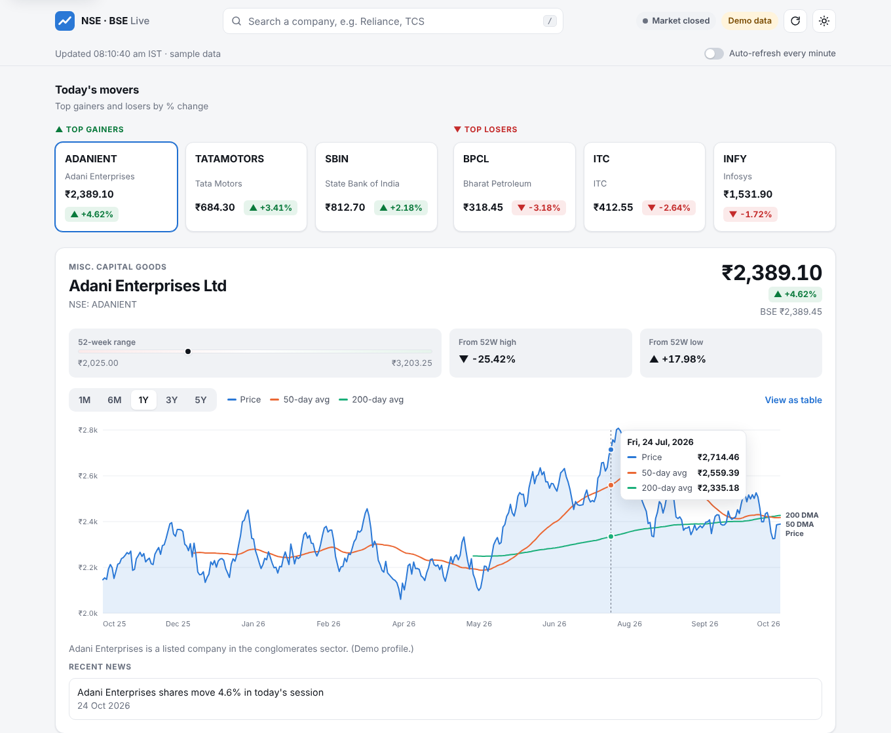

# NSE · BSE Live

An **MCP server** and a **web dashboard** for live Indian stock market data (NSE & BSE), powered by [IndianAPI](https://indianapi.in/).

- Ask Claude (or VS Code / Cursor) things like *"What are today's top gainers?"* or *"Show Reliance's 1-year price history"*.
- Open the dashboard to see movers, most-active stocks, 52-week highs/lows, price shockers, commodities, mutual funds and an interactive price chart for any company.

Based on [GirishKumarDV/Live-NSE-BSE-MCP](https://github.com/GirishKumarDV/Live-NSE-BSE-MCP), rebuilt on the official MCP Python SDK (v2) with the same 14 tools.



---

## 1. Install

Requires Python 3.10+.

```bash
git clone https://github.com/manojkm/nse-app.git
cd nse-app
python -m venv .venv
# macOS / Linux
source .venv/bin/activate
# Windows (PowerShell)
.venv\Scripts\Activate.ps1

pip install -e .
```

## 2. Add your API key

```bash
cp env.example .env      # Windows: copy env.example .env
```

Open `.env` and set:

```
ISE_API_KEY=your_indianapi_key
```

`.env` is git-ignored, so your key is never committed. **Without a key the app runs in demo mode** with sample data (marked "Demo data" in the UI).

## 3. Run the dashboard

```bash
python -m nse_mcp http
```

Open <http://127.0.0.1:8000>. The same process also serves MCP over HTTP at `http://127.0.0.1:8000/mcp`.

Options: `--port 9000`, `--host 0.0.0.0`, `--demo` (force sample data).

---

## Use it from Claude Desktop

Edit the config file:

- macOS: `~/Library/Application Support/Claude/claude_desktop_config.json`
- Windows: `%APPDATA%\Claude\claude_desktop_config.json`

```json
{
  "mcpServers": {
    "nse-bse": {
      "command": "/full/path/to/nse-app/.venv/bin/python",
      "args": ["-m", "nse_mcp"],
      "env": { "ISE_API_KEY": "your_indianapi_key" }
    }
  }
}
```

On Windows the command is `C:\\path\\to\\nse-app\\.venv\\Scripts\\python.exe`. Restart Claude Desktop afterwards.

## Use it from Claude Code

```bash
claude mcp add nse-bse --env ISE_API_KEY=your_indianapi_key -- /full/path/to/nse-app/.venv/bin/python -m nse_mcp
```

## Use it from VS Code / Cursor (HTTP)

Start `python -m nse_mcp http`, then add the server:

**VS Code** (`.vscode/mcp.json`):

```json
{ "servers": { "nse-bse": { "type": "http", "url": "http://127.0.0.1:8000/mcp" } } }
```

**Cursor** (`~/.cursor/mcp.json`):

```json
{ "mcpServers": { "nse-bse": { "url": "http://127.0.0.1:8000/mcp" } } }
```

---

## Tools

| Tool | What it returns |
|---|---|
| `get_trending_stocks` | Top gainers and losers |
| `get_nse_most_active` / `get_bse_most_active` | Most traded stocks by volume |
| `get_52_week_high_low` | Stocks near their 52-week high/low |
| `get_price_shockers` | Sharp short-term price moves |
| `get_commodities` | Commodity futures (gold, silver, crude…) |
| `get_stock_data` | Full company details by name or symbol |
| `search_industry` | Companies in an industry/sector |
| `get_historical_data` | Price history with 50/200-day averages |
| `get_historical_stats` | Results, balance sheet, cash flow, ratios, shareholding |
| `get_analyst_recommendations` | Target prices and buy/hold/sell breakdown |
| `get_stock_forecasts` | Forecasts/actuals for EPS, revenue, ROE… |
| `get_mutual_funds` | Mutual fund NAVs and returns by category |
| `search_mutual_funds` | Search fund schemes |

The dashboard uses the same tools through `GET /api/tools/<name>?param=value`.

## API quota

IndianAPI plans have request limits. To save quota:

- Identical requests are cached for 60 seconds (`ISE_CACHE_TTL`).
- Dashboard sections load only when you scroll to them.
- Auto-refresh is **off** by default and only runs while the market is open.

## Configuration

| Variable | Default | |
|---|---|---|
| `ISE_API_KEY` | – | IndianAPI key. Empty = demo mode |
| `ISE_API_BASE_URL` | `https://stock.indianapi.in` | |
| `ISE_HTTP_HOST` / `ISE_HTTP_PORT` | `127.0.0.1` / `8000` | |
| `ISE_REQUEST_TIMEOUT` | `30` | Seconds |
| `ISE_CACHE_TTL` | `60` | Seconds, `0` disables |
| `ISE_DEMO_MODE` | – | `1` forces sample data |
| `ISE_LOG_LEVEL` | `INFO` | |

## Project layout

```
nse_mcp/
  tools.py        the 14 tools (single source of truth for MCP + REST)
  server.py       MCP server, REST API, static hosting
  api.py          IndianAPI client (+ cache) and demo source
  sample_data.py  demo-mode data
  config.py       settings from env / .env
web/              dashboard (plain HTML/CSS/ES modules, no build step)
tests/            pytest suite
```

## Development

```bash
pip install -e ".[dev]"
pytest
```

The dashboard has no build step: edit files in `web/` and reload the page.

## Disclaimer

Market data may be delayed. Nothing here is investment advice.
